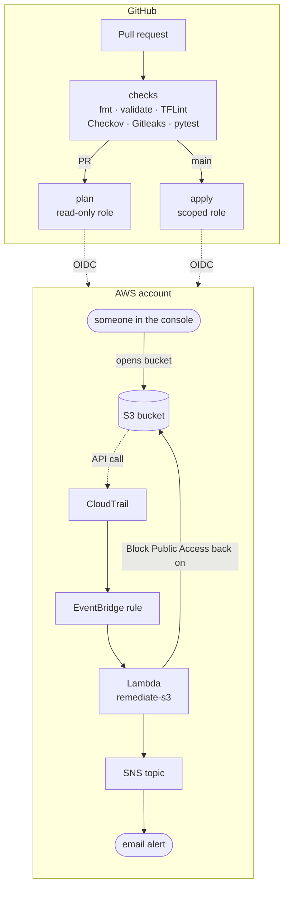
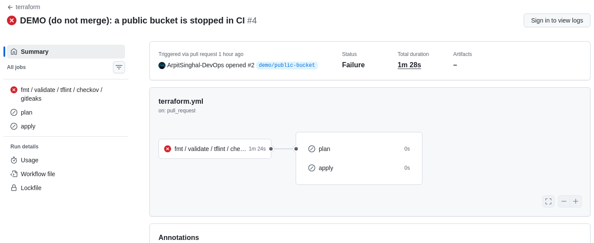
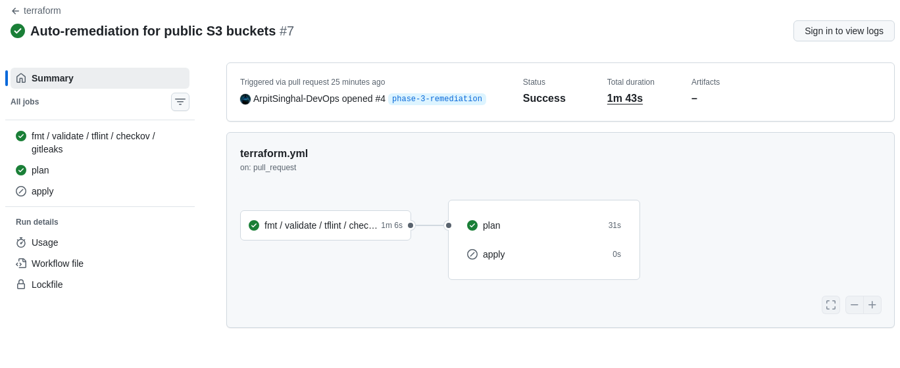
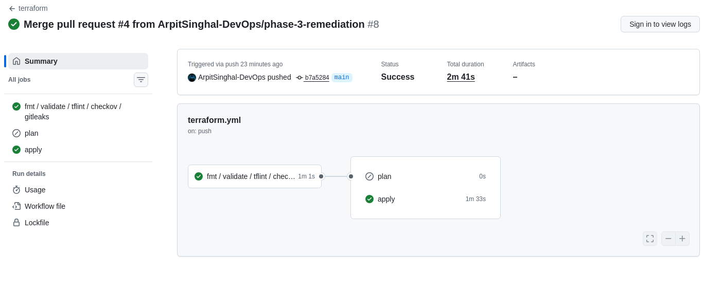

# CloudSentinel

Guardrails for a small AWS account, built with Terraform and GitHub Actions.

The same mistake, a publicly readable S3 bucket, gets caught in three places:

1. **Before deploy.** Every Terraform change is scanned in CI. A public bucket or an over-broad IAM policy fails the build and never reaches AWS.
2. **During deploy.** CI gets short-lived AWS credentials through OIDC. There are no access keys in GitHub, PRs can only plan, and only `main` can apply.
3. **After deploy.** If someone opens a bucket by hand in the console, CloudTrail records it, EventBridge triggers a Lambda, and Block Public Access is back on within about 10 seconds, with an email saying who did what.

Everything runs inside the AWS free tier, behind a $5 budget alarm.

## Architecture



## See it work

**A public bucket in a PR never gets past CI.**
[PR #2](https://github.com/ArpitSinghal-DevOps/cloudsentinel/pull/2) adds a bucket with the public access
blocks off and a `Principal: "*"` policy. Checkov fails the checks job with 12 findings, so plan never runs,
and the branch rules keep the PR from being merged.



**Normal changes go PR → plan → merge → apply,** with no AWS keys stored anywhere:




**A bucket opened by hand is closed again in about 10 seconds.** Output of `scripts/demo-public-bucket.sh`:

```
22:22:41  start: block public access = True True True True, anonymous GET = 403
22:22:45  removed Block Public Access
22:22:47  public-read policy added, anonymous GET = 200
22:22:53  Block Public Access back on after 10s, anonymous GET = 403
```

and the email that follows:

```
Subject: [CloudSentinel] public access removed from cloudsentinel-demo-<account-id>

Bucket cloudsentinel-demo-<account-id> was opened up and has been locked down again.

Change:      DeleteBucketPublicAccessBlock
Made by:     arn:aws:iam::<account-id>:user/arpit
Was off:     BlockPublicAcls, IgnorePublicAcls, BlockPublicPolicy, RestrictPublicBuckets
Policy was public: no

All four Block Public Access settings are back on. The bucket policy and ACL were not touched.
If this bucket really should be public, tag it cloudsentinel:allow-public=true.
```

## What it protects against

| Risk | Control | Where |
|---|---|---|
| A public or unencrypted bucket written in Terraform | Checkov fails the PR | CI, before plan |
| An IAM policy with `*` actions or resources | Checkov (CKV_AWS_109/111/356...) | CI |
| A secret committed to the repo | Gitleaks | CI |
| Leaked CI credentials | No stored keys; OIDC tokens last one hour and are tied to this repo's id | AWS STS |
| A PR changing real infrastructure | The PR role is read-only; only `main` can assume the apply role | IAM trust policy |
| CI making itself admin | The apply role can only create roles under `/cloudsentinel/` with a permissions boundary, and can't remove it | IAM |
| CI deleting the Terraform state | Explicit denies on the state bucket | IAM |
| A bucket opened by hand in the console | CloudTrail → EventBridge → Lambda turns Block Public Access back on | Runtime |
| A surprise bill | $5 budget alarm; the CI role can't create EC2, NAT or anything billed hourly | Budgets, IAM |

## Design decisions

- **OIDC instead of access keys.** Nothing long-lived to leak or rotate. The trust policies pin the GitHub
  owner and repo *ids*, not just names (see [the OIDC subject gotcha](#the-oidc-subject-gotcha)).
- **Two CI roles.** Pull requests come from branches anyone with write access can push to, so they only get
  read access. Applying is limited to `main`, which is protected.
- **A permissions boundary on everything CI creates.** Any role that can create IAM roles can escalate. The
  boundary caps every workload role at "close buckets, publish alerts, write logs".
- **Turn Block Public Access back on; don't delete the policy.** It closes the bucket just as well, it can be
  undone, and nothing in the bucket policy is lost.
- **An opt-out tag** (`cloudsentinel:allow-public=true`), because some buckets really are meant to be public,
  such as a static website.
- **Free-tier only.** SSE-S3 instead of KMS keys, one trail for management events only, no VPC for the
  Lambda. Each Checkov check skipped for these reasons has the reason next to it in the code.

## Layout

```
bootstrap/                      one-time setup, applied from a laptop with admin credentials
infra/                          the main stack, applied only by CI
infra/lambda/remediate_s3/      remediation Lambda and its tests
scripts/tf                      runs Terraform from the official Docker image (nothing to install)
scripts/demo-public-bucket.sh   opens the demo bucket and times the fix
.github/workflows/terraform.yml
```

## Bootstrap

`bootstrap/` holds the pieces that CI itself depends on, so it can't be applied by CI:

- **State bucket** `cloudsentinel-tfstate-<account-id>`: versioned, SSE-S3 encrypted, all public access blocked,
  TLS-only bucket policy, old versions expire after 90 days. Locking uses S3 lock files (`use_lockfile`),
  so there is no DynamoDB table.
- **GitHub OIDC provider** plus two roles:
  - `cloudsentinel-gha-plan`: assumable from any pull request in this repo. Read-only, and may only write
    `*.tflock` objects in the state bucket.
  - `cloudsentinel-gha-apply`: assumable only from workflows on `main`. Write access is limited to
    `cloudsentinel-*` resources (S3, CloudTrail, EventBridge, Lambda, SNS, Lambda log groups).
- **Permissions boundary** `cloudsentinel-workload-boundary`. The apply role can only create IAM roles under
  `/cloudsentinel/` and only with this boundary attached, and it can't remove it. Without that, a role that
  can create roles can create an admin role and use it. The boundary allows bucket lock-down actions, SNS
  publish and Lambda logging. No IAM, no object reads or writes.
- **Budget** `cloudsentinel-monthly`: $5/month, email at 50% and 100% actual, and at 100% forecast.

I checked the apply role with the IAM policy simulator:

| Attempt | Result |
|---|---|
| create role under `/cloudsentinel/` with the boundary | allowed |
| same role without the boundary | denied |
| create role outside `/cloudsentinel/` | denied |
| remove a role's boundary | denied (explicit) |
| attach a policy to the CI role itself | denied |
| delete or re-policy the state bucket | denied (explicit) |
| create a `cloudsentinel-*` bucket | allowed |
| create any other bucket | denied |
| launch an EC2 instance | denied |

Checkov: 100 passed, 0 failed. Six checks are skipped, each with a reason in the code (access logging,
replication, KMS CMK and event notifications on the state bucket; two on the boundary, which has to work on
every bucket by design).

### Running it the first time

Needs Docker and admin credentials in `~/.aws` (region `eu-north-1`).

```bash
cd bootstrap
cp terraform.tfvars.example terraform.tfvars     # set alert_email

# The bucket that will hold the state doesn't exist yet, so start on local state.
printf 'terraform {\n  backend "local" {}\n}\n' > backend_override.tf
../scripts/tf init
../scripts/tf apply

# Move the state into the bucket it just created.
cp backend.hcl.example backend.hcl               # put your account id in the bucket name
rm backend_override.tf
../scripts/tf init -migrate-state -backend-config=backend.hcl
rm terraform.tfstate terraform.tfstate.backup
```

After that it's a normal stack: `../scripts/tf plan`, `../scripts/tf apply`.

`terraform.tfvars`, `backend.hcl` and `*_override.tf` are git-ignored, so the alert email and the account id
stay out of the repo.

## CI

`.github/workflows/terraform.yml` has three jobs:

| Job | Runs on | What it does |
|---|---|---|
| checks | every PR and every push to main | `terraform fmt`, `validate` (both stacks), TFLint with the AWS ruleset, Checkov, Gitleaks |
| plan | PRs | assumes `cloudsentinel-gha-plan` through OIDC, runs `terraform plan` for `infra/` |
| apply | main | assumes `cloudsentinel-gha-apply`, plans, then applies that saved plan |

plan and apply only start if checks pass. The repo has four secrets: the two role ARNs, the state
bucket name and the alert email. There are no AWS keys anywhere. The account id is masked in the logs,
and the email is a sensitive variable, so the plan shows `(sensitive value)`.

`main` is protected: changes go through a PR, the checks and plan jobs must pass, and force-pushes
and deletes are blocked.

**Pre-deploy gate in action:** [PR #2](https://github.com/ArpitSinghal-DevOps/cloudsentinel/pull/2)
adds a bucket with public access blocks off and a `Principal: "*"` policy. Checkov fails it with 12
findings (CKV_AWS_53/54/55/56 for the access blocks, CKV_AWS_70 for the wildcard principal), so the
plan never runs. The PR stays open on purpose.

### The OIDC subject gotcha

The first plan run failed with `Not authorized to perform sts:AssumeRoleWithWebIdentity`. CloudTrail
showed the token's subject:

```
repo:ArpitSinghal-DevOps@144610884/cloudsentinel@1470357600:pull_request
```

GitHub includes the numeric owner and repo ids in the subject, so a trust policy matching
`repo:ArpitSinghal-DevOps/cloudsentinel:*` never matches. The roles now pin both ids. That is stricter
too: if the repo were deleted and someone re-created one with the same name, it would get a new id and
could not assume the roles.

## Auto-remediation

```
someone turns off Block Public Access / adds a public policy or ACL
        │
CloudTrail (management event)
        │
EventBridge rule cloudsentinel-s3-public-access
        │   PutBucketAcl, PutBucketPolicy, Put/DeleteBucketPublicAccessBlock
        ▼
Lambda cloudsentinel-remediate-s3
        ├─ bucket tagged cloudsentinel:allow-public=true?  → leave it
        ├─ all four Block Public Access settings already on? → nothing to do
        ├─ otherwise turn all four back on
        └─ email the alerts topic: which bucket, what changed, who did it
```

The Lambda doesn't delete the bucket policy or reset the ACL. With all four Block Public Access settings
on, S3 ignores public ACLs and public policies anyway, so turning them back on is enough, and nothing
someone wrote into the policy is lost. The fix itself produces a `PutBucketPublicAccessBlock` event that
comes back through EventBridge; the Lambda sees the bucket is already closed and stops there, so it can't loop.

The Lambda role sits under `/cloudsentinel/` with the workload boundary. Its own policy only allows reading
bucket tags and public-access status, turning Block Public Access on, publishing to the alerts topic and
writing its logs. It can't read objects.

Tests: 8 unit tests with [moto](https://github.com/getmoto/moto), run in the CI checks job (public bucket
gets closed, policy left untouched, already-closed is a no-op, allow-public tag respected, deleted bucket,
event without a bucket). Removing the actual fix from the handler makes 3 of them fail.

### Tested live

`scripts/demo-public-bucket.sh` uploads a file, removes Block Public Access, adds a public-read policy
and times how long until it's closed again. Its output is at the top of this README.

On another run the Lambda was quicker than the second step, and S3 refused the public policy outright:

```
22:21:03  removed Block Public Access
          PutBucketPolicy → AccessDenied: public policies are prevented by the BlockPublicPolicy setting
22:21:08  Lambda: {"status": "remediated", "trigger": "DeleteBucketPublicAccessBlock", "actor": "...:user/arpit", ...}
```

The alert email arrives a few seconds later.

One thing I hit: the very first test, a few minutes after the apply that created the trail and the rule,
wasn't caught at all. The rule matched the event (checked with `aws events test-event-pattern`), but nothing
reached it. A few minutes later every attempt was caught within 5 to 10 seconds. So a change made right after
a fresh deploy can slip through. A periodic sweep of all buckets would close that gap (see below).

### Not covered

- Account-level Block Public Access. Turning that on is the stronger fix for an account that never needs
  public buckets; this project handles the bucket level so there is something to demo.
- Object ACLs, and buckets made public through an access point.
- Changes that happen while EventBridge isn't delivering (like the case above). A scheduled Lambda that
  checks every bucket once a day would catch those.

## Cost

Everything here is free: IAM, OIDC and the first budget cost nothing, and the state bucket holds a few
hundred KB. Phase 3 adds one CloudTrail trail (write management events, free as the first trail; the log files are
a few KB a day and expire after 30 days), an EventBridge rule on AWS service events (free), and a Lambda
and an SNS topic that stay well inside their free tiers. Nothing that bills by the hour (NAT
gateways, load balancers, EC2, RDS), and the CI role can't create any of it.

## Tearing it down

To get back to zero, remove the main stack first (it needs the roles and the state bucket), then the bootstrap.

```bash
cd infra
../scripts/tf init -backend-config=bucket=cloudsentinel-tfstate-<account-id>
../scripts/tf destroy

cd ../bootstrap
# the state bucket has prevent_destroy; remove that line first, and empty the bucket
../scripts/tf destroy
```
